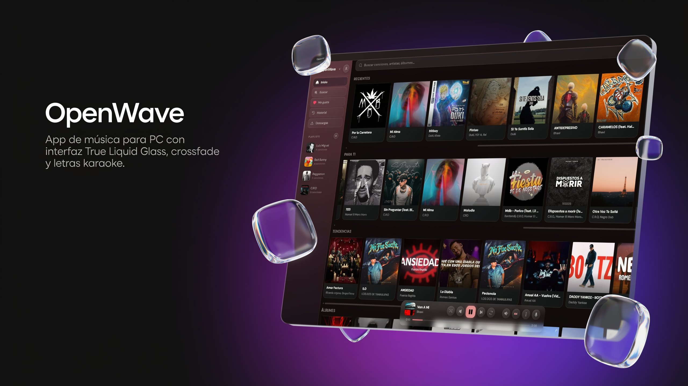
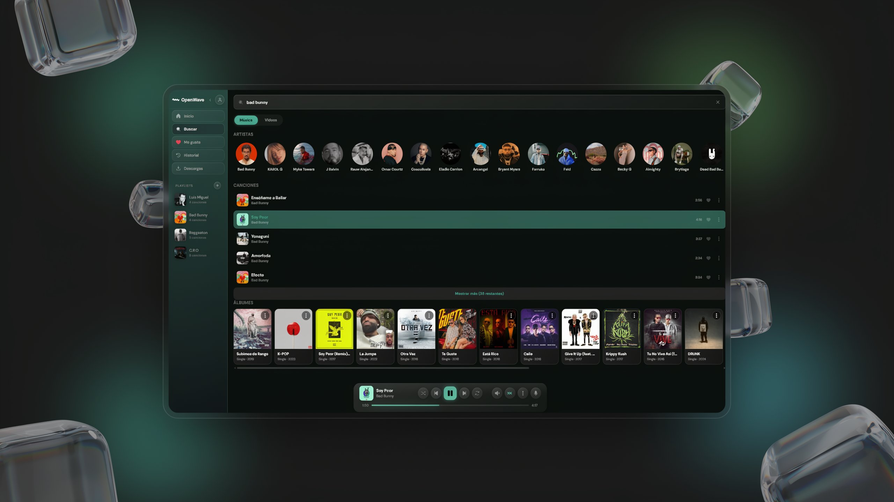

# 🎵 OpenWave — App de Música

App de música para PC usando **Tauri + React + FastAPI + ytmusicapi**.

- ✅ Streaming desde YouTube Music con **crossfade estilo Spotify** (fade simultáneo A→B)
- ✅ **Cola inteligente** (rellenada desde resultados y relacionados, con feedback de reproducción)
- ✅ **Letras sincronizadas** estilo karaoke (LRCLib + YTMusic + Genius)
- ✅ **Temas dinámicos** — colores extraídos de la portada del álbum
- ✅ Vistas de **Álbum, Artista y Playlist**, historial y likes
- ✅ Descarga offline con yt-dlp
- ✅ UI oscura con glassmorphism (True Liquid Glass)
- ✅ Instalador .MSI para Windows
- ✅ Suite de **tests**: 970 tests unitarios (Vitest) + e2e (Playwright) + Pytest

---

## 📸 Capturas

| Inicio | Reproducción |
|:---:|:---:|
|  |  |

| Letras sincronizadas |
|:---:|
|  |

---

## 📥 Descarga e instalación (usuarios)

1. Descarga el instalador `OpenWave-*-x64-es-ES.msi` desde la [página de
   Releases](https://github.com/JharrysA2/OpenWave/releases).
2. Ejecútalo y acepta el diálogo de Windows. SmartScreen puede avisar de que
   el editor es desconocido (app sin firma comercial): «Más información» →
   «Ejecutar de todos modos».
3. Requisitos: Windows 10 o 11 con WebView2 (incluido en Windows 11; en
   Windows 10 se instala desde la web de Microsoft).
4. La primera ejecución necesita internet (catálogo de YouTube Music). Las
   canciones **descargadas** se reproducen sin conexión desde la pestaña
   Descargas.

**Actualizaciones**: 1.0.0 no trae actualizador automático — descarga el MSI
más reciente e instálalo por encima de la versión anterior; tus datos
(descargas, playlists, historial y preferencias) se conservan.

**Datos**: todo se guarda en tu equipo (base de datos, descargas, letras y
preferencias en `C:\ProgramData\OpenWave` y el perfil de usuario). La app no
recopila ni envía telemetría.

---

## 📋 Requisitos

- [Node.js](https://nodejs.org/) 18+
- [Rust](https://rustup.rs/) — `rustup install stable`
- [Python](https://python.org/) 3.10+
- [Visual Studio Build Tools](https://visualstudio.microsoft.com/visual-cpp-build-tools/) (Windows)
- [WebView2](https://developer.microsoft.com/es-es/microsoft-edge/webview2/) (ya incluido en Windows 11)

---

## 🚀 Instalación y desarrollo

```bash
# 1. Frontend
npm install

# 2. Backend
cd backend
pip install -r requirements.txt
cd ..

# 3. Ejecutar en desarrollo (dos terminales)
# Terminal 1 — Backend Python:
cd backend && python main.py

# Terminal 2 — App Tauri:
npm run tauri dev
```

> 💡 Alternativa en Windows: ejecuta `start.bat`, que inicia el backend y la app automáticamente.

---

## 📦 Scripts disponibles

| Script | Descripción |
|--------|-------------|
| `npm run dev` | Inicia Vite dev server |
| `npm run build` | Build de producción (Vite) |
| `npm run preview` | Previsualiza el build |
| `npm run tauri [dev]` | Comandos de Tauri |
| `npm test` | Tests unitarios (Vitest, modo run) |
| `npm run test:watch` | Vitest en watch |
| `npm run test:ui` | Vitest con UI |
| `npm run test:e2e` | Tests e2e (Playwright) |
| `npm run test:e2e:ui` | Playwright con UI |
| `npm run test:e2e:debug` | Playwright en modo debug |
| `npm run lint` | ESLint (frontend `src/`) |
| `npm run lint:fix` | ESLint con auto-fix |
| `npm run format` | Prettier (formateo frontend) |
| `npm run format:check` | Verifica formato Prettier |
| `npm run check` | ESLint + Prettier check |
| `npm run prepare` | Inicializa Husky (pre-commit hooks) |
| `ruff check backend/` | Ruff linter (backend Python) |
| `ruff format backend/` | Ruff formatter (backend) |
| `python -m pytest` | Tests del backend (en `backend/`) |
| `scripts/sync-windows` | (WSL) Sincroniza la copia de trabajo de Windows con este repo |
| `scripts/generate-license.ps1` | (Windows) Genera `build/windows/licencia.txt` para el diálogo de licencia del MSI |
| `scripts/prepare-runtime.ps1` | (Windows) Prepara Python embebido + dependencias + ffmpeg en `build/staging` |
| `scripts/package-windows.ps1` | (Windows) Construye el instalador MSI completo → `build/windows/` |
| `scripts/verify-msi.ps1` | (Windows) Verificación estática del MSI compilado: 75 comprobaciones sobre sus tablas y su payload, sin instalar |

Guía completa del instalador (pasos, decisiones de diseño y checklist de
aceptación): **[docs/instalador/README.md](docs/instalador/README.md)**.

---

## 🗂️ Estructura del proyecto

```
openwave/
├── .github/workflows/
│   └── ci.yml                 ← CI: lint + format + build + tests (frontend) y ruff + pytest (backend)
├── .husky/
│   └── pre-commit             ← Ejecuta lint-staged antes de cada commit
├── e2e/                       ← Tests e2e (Playwright)
│   ├── helpers.js
│   └── *.spec.js
├── public/                    ← Assets estáticos (logo, favicon)
├── src/                       ← Frontend React
│   ├── App.jsx                ← Entry point (enrutado, dynamic theme, player)
│   ├── main.jsx
│   ├── constants.js
│   ├── components/            ← 54 componentes UI
│   │   ├── AlbumView.jsx          HomeView.jsx        PlaylistView.jsx
│   │   ├── ArtistView.jsx         LikedView.jsx       SearchView.jsx
│   │   ├── ConfirmModal.jsx       LyricsView.jsx      SelectionModal.jsx
│   │   ├── ConnectionBanner.jsx   MusicCover.jsx      SettingsComponents.jsx
│   │   ├── CreatePlaylistModal.jsx PlayerBar.jsx      SettingsPanel.jsx
│   │   ├── DownloadsView.jsx      SkeletonLoader.jsx  SettingsPages.jsx
│   │   ├── ErrorBoundary.jsx      SongOptionsSheet.jsx Toast.jsx
│   │   ├── HistoryView.jsx        TrackPickerModal.jsx
│   ├── hooks/                  ← 6 hooks
│   │   ├── useToast.js
│   │   ├── usePlayer.js        ← reproducción, crossfade, cola inteligente
│   │   ├── useLibrary.js
│   │   ├── useSearch.js
│   │   ├── useBackendStatus.js
│   │   └── useDynamicTheme.js  ← tema dinámico desde la portada (rAF + --neon)
│   ├── contexts/
│   │   └── SettingsContext.jsx / useSettings.js
│   ├── icons/
│   │   └── Icons.jsx
│   ├── utils/
│   │   ├── api.js              ← cliente HTTP del backend
│   │   ├── backendHealth.js
│   │   ├── formatTime.js
│   │   ├── lrc.js              ← parser .lrc (multi-timestamp, offset)
│   │   ├── playerStyles.js
│   │   ├── theme.js            ← design tokens (colores, tipografía, radios, glass)
│   │   ├── thumbnails.js
│   │   └── windowControls.js
│   └── i18n/
│       └── translations.js
├── backend/                    ← Backend Python (FastAPI)
│   ├── main.py                 ← Entry point (health, thumbnail-proxy)
│   ├── config.py
│   ├── db.py
│   ├── ytmusic_client.py
│   ├── cache.py
│   ├── logging_config.py
│   ├── rate_limit.py
│   ├── utils.py
│   ├── streaming.py
│   ├── downloads.py
│   ├── lyrics.py
│   ├── conftest.py             ← Fixtures de pytest
│   ├── test_*.py               ← Tests (pytest)
│   ├── requirements.txt
│   └── routes/
│       ├── __init__.py
│       ├── search.py
│       ├── songs.py
│       ├── streaming.py
│       ├── downloads_routes.py
│       ├── playlists.py
│       ├── history.py
│       └── lyrics_routes.py
├── src-tauri/                  ← Tauri (Rust)
│   ├── src/
│   │   ├── main.rs
│   │   └── lib.rs
│   ├── capabilities/migrated.json
│   ├── icons/
│   ├── build.rs
│   ├── Cargo.toml / Cargo.lock
│   └── tauri.conf.json
├── DESIGN.md                    ← System design (paleta, tipografía, glass)
├── .prettierrc
├── .prettierignore
├── eslint.config.js
├── pyproject.toml               ← Ruff config (backend Python)
├── playwright.config.js
├── package.json
└── vite.config.js
```

---

## 🔌 API Endpoints

### Sistema

| Método | Ruta | Descripción |
|--------|------|-------------|
| GET | `/health` | Salud del backend |
| GET | `/thumbnail-proxy` | Proxy de miniaturas (CORS) |

### Búsqueda y home

| Método | Ruta | Descripción |
|--------|------|-------------|
| GET | `/search?q=&limit=` | Buscar canciones, artistas, álbumes |
| GET | `/search/videos?q=` | Buscar videos |
| GET | `/trending` | Tendencias |
| GET | `/home/quick-picks` | Reproducciones recientes |
| GET | `/home/for-you` | Recomendaciones personalizadas |
| GET | `/home/albums` | Álbumes sugeridos |
| GET | `/home/trending-fixed` | Tendencias fijas |

### Canciones y reproducción

| Método | Ruta | Descripción |
|--------|------|-------------|
| GET | `/stream-url/{videoId}` | URL de streaming |
| GET | `/stream/play/{videoId}` | Reproducción vía proxy |
| GET | `/stream/{videoId}` | Stream de archivo local |
| GET | `/stream/prefetch/{videoId}` | Precargar en caché |
| GET | `/song/details/{videoId}` | Detalles de canción |
| GET | `/song/album/{videoId}` | Álbum de canción |
| GET | `/album/{browseId}` | Detalles de álbum |
| GET | `/artist/{browseId}` | Detalles de artista |
| GET | `/artist/related/{browseId}` | Artistas relacionados |
| GET | `/queue/{videoId}` | Cola de reproducción (radio de YTM) |
| POST | `/queue/feedback` | Feedback de reproducción (completada) |

> `GET /queue/{videoId}` construye la radio de YouTube Music (watch playlist,
> con fallbacks a watch playlist normal y a búsqueda) y **rota el orden en cada
> petición**: al volver a reproducir la misma canción, la cola que llega al
> cliente siempre cambia (refresco estilo YouTube Music; la caché de 600 s solo
> protege la llamada a YouTube, no fija el orden). Requiere
> `ytmusicapi>=1.12.3` — en 1.7.3 `get_watch_playlist` fallaba con
> `KeyError 'endpoint'` y la cola salía siempre del mismo fallback de búsqueda.

### Descargas

| Método | Ruta | Descripción |
|--------|------|-------------|
| POST | `/download/{videoId}` | Iniciar descarga |
| GET | `/download/progress/{videoId}` | Progreso de descarga |
| GET | `/downloads` | Listar descargas |
| DELETE | `/downloads/{videoId}` | Eliminar descarga |
| DELETE | `/downloads/all` | Limpiar todas |
| POST | `/downloads/delete` | Eliminar selección |

### Playlists e historial

| Método | Ruta | Descripción |
|--------|------|-------------|
| GET | `/playlists` | Listar playlists |
| POST | `/playlists` | Crear playlist |
| PUT | `/playlists/{pid}` | Renombrar/actualizar playlist |
| DELETE | `/playlists/{pid}` | Eliminar playlist |
| GET | `/playlists/{pid}/songs` | Canciones de una playlist |
| POST | `/playlists/{pid}/songs` | Agregar canciones |
| DELETE | `/playlists/{pid}/songs/{videoId}` | Quitar canción |
| POST | `/playlists/{pid}/reorder` | Reordenar |
| GET | `/history` | Historial |
| POST | `/history` | Registrar reproducción |
| DELETE | `/history` | Eliminar una entrada |
| DELETE | `/history/all` | Limpiar historial |
| GET/POST | `/player/state` | Persistencia del estado del player |

### Letras

| Método | Ruta | Descripción |
|--------|------|-------------|
| GET | `/lyrics/{videoId}` | Letras automáticas |
| GET | `/lyrics/search` | Buscar letras |
| GET | `/lyrics/local/{videoId}` | Letras locales (.lrc) |

---

## 🧪 QA y calidad de código

- **ESLint** — Reglas para React 18 + JSX + Hooks
- **Prettier** — Formateo automático
- **Vitest** — 970 tests unitarios en 57 ficheros (componentes, hooks y utils del frontend)
- **Playwright** — Tests e2e (navegación, búsqueda, reproducción, settings, librería)
- **Ruff** — Linter y formatter para Python backend
- **Pytest** — 444 tests del backend (rutas, DB, streaming, descargas, letras, utils)
- **Husky + lint-staged** — Pre-commit hook que ejecuta Prettier + ESLint automáticamente
- **GitHub Actions CI** — Frontend: lint + formato + build + `npm test`; Backend: ruff + pytest

---

## ⚠️ Notas legales

- **Licencia del código**: [CC BY-NC 4.0](LICENSE) — libre para uso
  personal: puedes copiarlo, modificarlo y redistribuirlo citando al autor,
  pero **no con fines comerciales** ni con ánimo de lucro.
- OpenWave consulta contenido a través de la **API privada de YouTube
  Music** (`ytmusicapi`, reverse engineering). No está afiliada, patrocinada
  ni respaldada por Google ni por YouTube; el acceso queda sujeto a las
  [Condiciones de Servicio de Google](https://www.youtube.com/t/terms) y la
  disponibilidad del contenido depende de terceros.
- Para uso personal funciona sin problemas. Para un servicio público o
  comercial, la alternativa legal sería la
  [YouTube Data API v3](https://developers.google.com/youtube/v3) oficial
  (gratuita con límites).
- El software se distribuye «tal cual», sin garantía de ningún tipo (Sección
  5 de la licencia).
